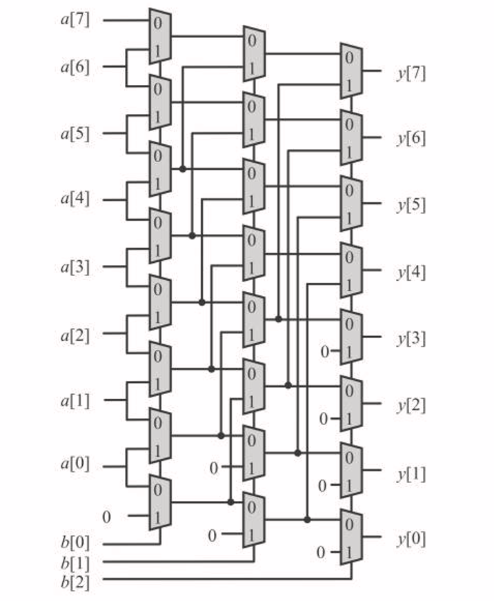
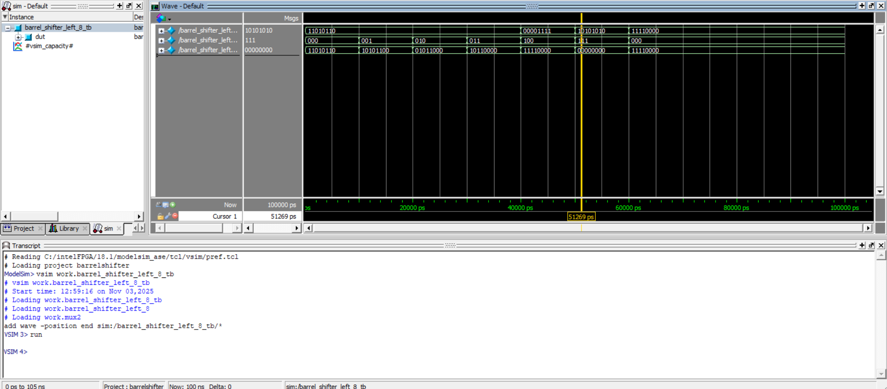

# 8-Bit Left Barrel Shifter

This exercise implements an **8-bit logical left barrel shifter** in Verilog. The circuit performs a **logical left shift** on an 8-bit input and supports shift amounts from **0 to 7**.

## Assignment Circuit

The following diagram is the circuit provided in the assignment statement and was used as the basis for the Verilog implementation.

## Design Overview

The barrel shifter is implemented using a **three-stage multiplexer-based structure**:

- **Stage 1:** optional shift by **1** bit
- **Stage 2:** optional shift by **2** bits
- **Stage 3:** optional shift by **4** bits

The three bits of the control input `b[2:0]` determine the total shift amount. By combining these stages, the design can generate every shift from **0 to 7 bits**. Vacated positions are filled with zeros.

## Simulation

The design was simulated in **ModelSim** using different input values and shift amounts to verify correct logical left-shift behavior.

