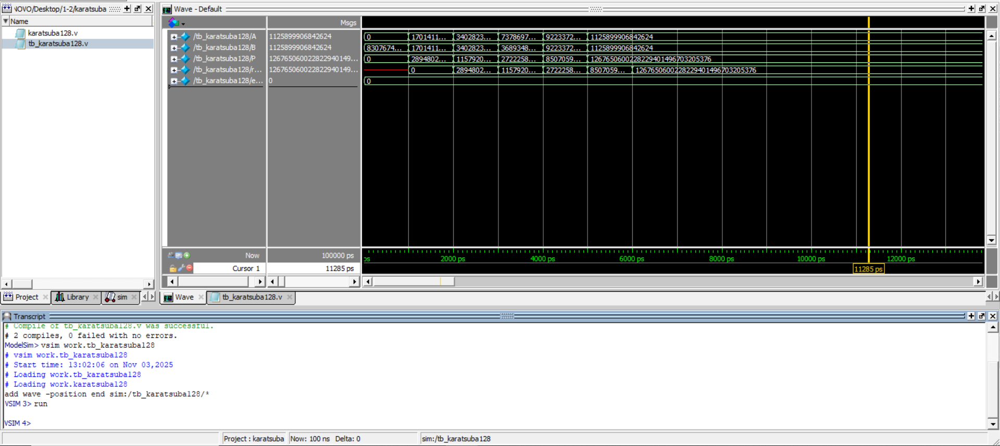

# Karatsuba Multiplier

This project implements multiplication in Verilog using the **Karatsuba algorithm**.

## 128-Bit Implementation

Two 128-bit operands are divided into 64-bit halves and combined using:

```text
Z1 = A1 × B1
Z2 = A0 × B0
Z3 = (A1 + A0) × (B1 + B0) - Z1 - Z2
```

The final 256-bit product is reconstructed from these partial results.

## Generic Version

The `Generic-Version` directory contains a parameterized implementation using `N` as the operand width. This allows the same module structure to support different even input sizes.

- `Generic-Version/karatsuba.v` — parameterized Karatsuba multiplier
- `Generic-Version/tb_karatsuba128.v` — testbench using `N = 128`

## Simulation

The design was verified in **ModelSim** using representative test cases.



