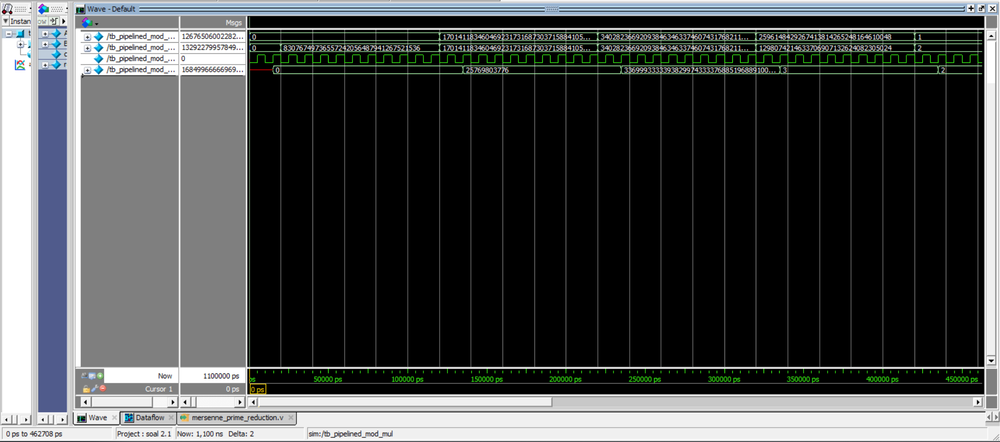

# Pipelined Modular Multiplier

This project implements a **two-cycle pipelined modular multiplier** in Verilog for two 128-bit inputs using:

- **Karatsuba multiplication** in the first pipeline stage
- **Pseudo-Mersenne prime reduction** in the second stage

The modulus is:

```text
p = 2^221 - 3
```

## Pipeline

- **Cycle 1:** computes and registers the 256-bit Karatsuba product.
- **Cycle 2:** reduces the product modulo `2^221 - 3` using an unrolled Pseudo-Mersenne reduction.

## Simulation


